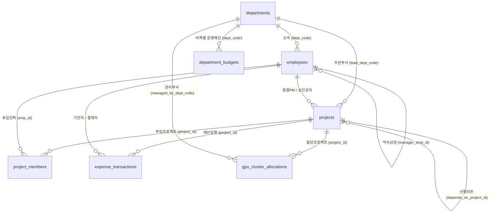

# 🗄️ (주)넥스트AI 엔터프라이즈 ERP 데이터베이스 (`enterprise_erp.db`)

본 디렉터리는 **엔터프라이즈 Agentic RAG (Text2SQL + Vector DB + GraphRAG 하이브리드 추론)** 실습 및 평가를 위해 설계된 정규화 관계형 데이터베이스(`SQLite 3`)와 시드 스크립트를 포함합니다.

---

## 1. 파일 구성 및 동기화 경로

| 구분 | 경로 | 설명 |
| :--- | :--- | :--- |
| **시드 스크립트** | `data/enterprise_erp_sql/seed_enterprise_erp.py` | 7개 정규화 테이블 생성, 시드 데이터 적재 및 5대 검증 쿼리 실행 |
| **원본 DB** | `data/enterprise_erp_sql/enterprise_erp.db` | 시드 스크립트가 생성하는 마스터 SQLite DB 파일 |
| **시멘틱 레이어** | `data/enterprise_erp_sql/semantic_layer.yaml` | 테이블·컬럼 설명, 동의어, 비즈니스 규칙, 지표 정의. `rag.sql.DatabaseProfile.load()`가 DB 구조(PRAGMA)와 합쳐 Text2SQL 프로필을 만듦 |
| **런타임 DB** | `app/database/enterprise_erp.db` | 에이전트 런타임(`rag.sql.Text2SQL`)에서 참조하는 동일 복제본 |

---

## 2. 관계형 스키마(ERD) 요약 및 테이블 현황 (`PRAGMA foreign_keys = ON`)

단일 테이블 단순 조회(`SELECT * FROM ...`)만으로는 복합 질문에 답할 수 없도록 **PK-FK 정규화**가 적용되어 있으며, 특히 프로젝트별 실집행액(`spent_budget_krw`) 컬럼을 `projects` 테이블에서 의도적으로 배제하여 반드시 `expense_transactions` 테이블과 `JOIN` + `GROUP BY` 집계를 수행해야만 예산 집행률을 계산할 수 있도록 설계되었습니다.



| 번호 | 테이블명 | 행 수 (Rows) | PK | 주요 FK 및 설계 포인트 |
| :---: | :--- | :---: | :--- | :--- |
| **1** | `departments` | **7** | `dept_code` | 4개 본부(`클라우드사업본부`, `AI혁신본부`, `경영지원본부`, `CISO직속`) 산하 7개 팀 마스터 및 부서 약칭(`클운팀`, `인프라팀`, `에이팀`, `데플팀` 등) |
| **2** | `employees` | **40** | `emp_id` | 본부장/CISO(4명), 팀장(7명), 핵심 실무자(7명) 및 일반 팀원(22명). `dept_code`(FK), 자기참조 `manager_emp_id`(FK) |
| **3** | `projects` | **6** | `project_id` | `P-01` ~ `P-06` 전사 전략 과제. `lead_dept_code`, `pm_emp_id`, `approver_emp_id`, `depends_on_project_id`(FK). **실집행액 컬럼 미포함** |
| **4** | `project_members` | **52** | `id` | 프로젝트-임직원 `N:M` 매핑. `최책임`(`EMP-2021-001`)의 `P-01`(50%) 및 `P-02`(50%, `'파견협업'`) 동시 투입 반영 |
| **5** | `expense_transactions` | **135** | `tx_id` | `TX-2026-0001` ~ `TX-2026-0135`. `'승인완료'`, `'결재대기'`, `'반려'` 상태 및 출장/GPU임차/외주/보안감사 내역 |
| **6** | `gpu_cluster_allocations` | **10** | `allocation_id` | `GPU-CLUST-01` ~ `GPU-CLUST-10`. GPU 모델(`H100`/`A100`/`L40S`), 서빙 엔진(`vLLM (PagedAttention)` vs `TGI`), KV 캐시 낭비율 및 가동률 |
| **7** | `department_budgets` | **20** | `budget_id` | `BUD-2026-01` ~ `BUD-2026-20`. 전사위임전결및예산집행규정 [별표 2]·[별표 5]의 부서별·비목별 운영 예산 원장. `dept_code`(FK), 비목별 ERP 계정 코드(`ACC-5101` 등), 편성액(`allocated_krw`)·누적 집행액(`spent_krw`). 부서별 편성액 합계 = `departments.annual_budget_krw`. **집행률 컬럼 미포함** (조회 시 계산) |

---

## 3. 핵심 교육용 복합 질의 시나리오 (A / B / C / D / E) 및 정답 SQL

### 📌 시나리오 A: 예산 집행률 80% 초과 조기경보 프로젝트 검출 (SQL 다중 JOIN + GROUP BY 집계)
* **질문 예시**: *"현재 진행 중인 전사 전략 프로젝트 중 승인완료된 실집행액 기준으로 예산 집행률이 80%를 초과하여 조기 경보 대상인 프로젝트의 명칭, 주관 부서, 총괄 PM, 승인 예산, 실집행액, 집행률(%)을 구하시오."*
* **설계 의도**: `projects` 테이블에는 `approved_budget_krw`(승인 예산)만 존재하므로, `expense_transactions`에서 `approval_status = '승인완료'`인 거래만 필터링·합산(`SUM`)한 뒤 `departments`, `employees`와 다중 조인해야 합니다.
* **정답 데이터**:
  - **`P-02` (엔터프라이즈 Agentic RAG 플랫폼 구축)**: 주관 `AgenticAI팀`, PM `홍팀장 수석`, 승인예산 `480,000,000원`, 실집행액 `412,800,000원` (**집행률 `86.0%`**)
  - **`P-05` (멀티클라우드 GPU 추론 클러스터 고도화)**: 주관 `인프라엔지니어링팀`, PM `정수석 수석`, 승인예산 `620,000,000원`, 실집행액 `527,000,000원` (**집행률 `85.0%`**)

```sql
SELECT
    p.project_id,
    p.project_name,
    d.dept_name AS lead_dept,
    pm.name || ' ' || pm.rank AS pm_name,
    p.approved_budget_krw,
    SUM(CASE WHEN tx.approval_status = '승인완료' THEN tx.amount_krw ELSE 0 END) AS spent_budget_krw,
    ROUND(
        SUM(CASE WHEN tx.approval_status = '승인완료' THEN tx.amount_krw ELSE 0 END) * 100.0
        / p.approved_budget_krw, 2
    ) AS burn_rate_pct
FROM projects p
JOIN departments d ON p.lead_dept_code = d.dept_code
JOIN employees pm ON p.pm_emp_id = pm.emp_id
LEFT JOIN expense_transactions tx ON p.project_id = tx.project_id
GROUP BY p.project_id
HAVING burn_rate_pct >= 80.0
ORDER BY burn_rate_pct DESC;
```

---

### 📌 시나리오 B: 사내 여비 규정(제14조 숙박비 한도) 위반 '결재대기' 품의 감사 (Vector DB 규정 검색 + SQL JOIN)
* **질문 예시**: *"사내 국내 여비 및 교통비 지급 규정(제14조)의 직급별·지역별 숙박비 상한액을 기준으로, 현재 ERP에서 '결재대기' 중인 '국내출장' 품의 가운데 1박당 숙박비 한도를 초과하여 위반한 내역(전표번호, 기안자 성명·직급, 출장지, 박수, 청구금액, 규정 상한액)을 모두 찾아내시오."*
* **설계 의도**: Vector DB(`2026_국내여비교통비지급규정.md` 제14조 표)에서 직급별(`임원`, `수석/책임`, `선임/전임`) 및 지역별(`서울/수도권`, `광역시/특례시`, `기타 지방`) 1박 상한액을 먼저 조회한 후, SQLite에서 `expense_transactions`와 `employees`를 조인해 위반 건을 색출합니다.
* **정답 데이터 (총 3건 적발)**:
  1. **`TX-2026-0131`**: `이선임` (`선임`/`팀원`, `클라우드운영팀`), `P-01`, **서울 1박 `150,000원`** 청구 (팀원 서울 1박 상한 `100,000원` 대비 **`50,000원` 초과**)
  2. **`TX-2026-0132`**: `윤에이전트` (`책임`, `AgenticAI팀`), `P-02`, **부산 2박 `280,000원` (1박당 `140,000원`)** 청구 (수석/책임 광역시 1박 상한 `100,000원` 대비 **1박당 `40,000원` / 총 `80,000원` 초과**)
  3. **`TX-2026-0133`**: `장LLM` (`선임`/`팀원`, `AgenticAI팀`), `P-02`, **대전 1박 `120,000원`** 청구 (팀원 광역시 1박 상한 `80,000원` 대비 **`40,000원` 초과**)

```sql
SELECT
    tx.tx_id,
    tx.project_id,
    e.name AS requester_name,
    e.rank AS requester_rank,
    d.dept_name,
    tx.destination_city,
    tx.nights,
    tx.amount_krw,
    CAST(tx.amount_krw / tx.nights AS INTEGER) AS claimed_per_night_krw,
    CASE
        WHEN e.rank IN ('전무', '상무') AND tx.destination_city = '서울' THEN 200000
        WHEN e.rank IN ('전무', '상무') AND tx.destination_city IN ('부산', '대구', '대전') THEN 160000
        WHEN e.rank IN ('전무', '상무') THEN 130000
        WHEN e.rank IN ('수석', '책임') AND tx.destination_city = '서울' THEN 130000
        WHEN e.rank IN ('수석', '책임') AND tx.destination_city IN ('부산', '대구', '대전') THEN 100000
        WHEN e.rank IN ('수석', '책임') THEN 90000
        WHEN e.rank IN ('선임', '전임') AND tx.destination_city = '서울' THEN 100000
        WHEN e.rank IN ('선임', '전임') AND tx.destination_city IN ('부산', '대구', '대전') THEN 80000
        ELSE 70000
    END AS policy_limit_per_night_krw
FROM expense_transactions tx
JOIN employees e ON tx.requester_emp_id = e.emp_id
JOIN departments d ON e.dept_code = d.dept_code
WHERE tx.approval_status = '결재대기'
  AND tx.category = '국내출장'
  AND (tx.amount_krw / tx.nights) > policy_limit_per_night_krw
ORDER BY tx.tx_id;
```

---

### 📌 시나리오 C: 위임전결 규정(5,000만원 이상 본부장 전결) 위반 '결재대기' 품의 적발 (GraphRAG 조직/전결 규정 + SQL 자기참조 JOIN)
* **질문 예시**: *"사내 위임전결 규정에 따르면 5,000만원 미만의 비용만 팀장(수석)이 전결할 수 있고, 5,000만원 이상 5억원 미만은 소속 본부장(전무/상무)이 최종 승인해야 한다. 현재 '결재대기' 중인 지출 결의 내역 중 금액이 5,000만원 이상인데도 결재자가 '팀장'으로 잘못 지정된 건을 찾아 올바른 전결권자(소속 본부장)를 제시하시오."*
* **정답 데이터 (총 2건 적발)**:
  1. **`TX-2026-0134`**: `P-02`, 기안자 `윤에이전트(책임)`, 품목 `'GPU클러스터임차'`, 금액 **`65,000,000원`** — 현 결재자 `홍팀장(수석/팀장)` $\rightarrow$ **`송본부장(상무/AI혁신본부장)`** 으로 결재선 변경 필요
  2. **`TX-2026-0135`**: `P-05`, 기안자 `강엔지니어(선임)`, 품목 `'GPU클러스터임차'`, 금액 **`58,000,000원`** — 현 결재자 `정수석(수석/팀장)` $\rightarrow$ **`박영희(전무/클라우드사업본부장)`** 으로 결재선 변경 필요

```sql
SELECT
    tx.tx_id,
    tx.project_id,
    p.project_name,
    req.name || '(' || req.rank || ')' AS requester,
    app.name || '(' || app.rank || '/' || app.role || ')' AS wrong_approver,
    mgr.name || '(' || mgr.rank || '/' || mgr.role || ')' AS correct_division_head,
    tx.category,
    tx.amount_krw,
    tx.description
FROM expense_transactions tx
JOIN projects p ON tx.project_id = p.project_id
JOIN employees req ON tx.requester_emp_id = req.emp_id
JOIN employees app ON tx.approver_emp_id = app.emp_id
LEFT JOIN employees mgr ON app.manager_emp_id = mgr.emp_id
WHERE tx.approval_status = '결재대기'
  AND tx.amount_krw >= 50000000
  AND app.role = '팀장'
ORDER BY tx.amount_krw DESC;
```

---

### 📌 시나리오 D: GPU 클러스터 유휴 회수 대상(`<30%`) 및 구형 서빙 엔진(`TGI`) KV 캐시 낭비 분석 (논문 PDF + 운영지침 + SQL 결합)
* **질문 예시**: *"사내 GPU 인프라 운영 지침상 주간 평균 가동률(`avg_utilization_pct`)이 30% 미만인 유휴 회수 대상 클러스터를 식별하고, 해당 클러스터들이 사용하는 서빙 엔진(`TGI`)의 KV 캐시 메모리 낭비율(`kv_cache_waste_pct`)을 vLLM(`PagedAttention`) 도입 클러스터들과 비교하여 아키텍처 개선 방안을 제시하시오."*
* **정답 데이터**:
  - **유휴 회수 및 엔진 전환 1순위 클러스터 (2건)**:
    1. **`GPU-CLUST-04`** (`P-03`, 관리부서 `데이터플랫폼팀`, PM `유수석`): `NVIDIA A100-80GB` 16기(2노드), 서빙 엔진 **`TGI`**, 평균 가동률 **`18.5%`** (`<30%` 유휴 회수 대상), **KV 캐시 메모리 낭비율 `62.4%`**, 월 비용 `24,000,000원`
    2. **`GPU-CLUST-08`** (`P-06`, 관리부서 `데이터플랫폼팀`, PM `유수석`): `NVIDIA L40S-48GB` 16기(2노드), 서빙 엔진 **`TGI`**, 평균 가동률 **`24.0%`** (`<30%` 유휴 회수 대상), **KV 캐시 메모리 낭비율 `58.7%`**, 월 비용 `16,000,000원`
  - **추가 `TGI` 전환 권고 클러스터**:
    - **`GPU-CLUST-02`** (`P-02`, 관리부서 `AgenticAI팀`): 가동률은 `64.2%`로 정상이나 구형 `TGI` 엔진 사용으로 **KV 캐시 낭비율이 `61.5%`** 에 달함 (동일 프로젝트의 `GPU-CLUST-01`은 `vLLM (PagedAttention)`을 적용해 **KV 캐시 낭비율 `3.2%`** 달성 — vLLM 논문의 `<4%` 메모리 낭비율 수치와 정합).

```sql
SELECT
    g.allocation_id,
    g.project_id,
    p.project_name,
    d.dept_name AS managed_by_dept,
    pm.name || ' ' || pm.rank AS project_pm,
    g.gpu_model,
    g.node_count * g.gpus_per_node AS total_gpus,
    g.serving_engine,
    g.kv_cache_waste_pct,
    g.avg_utilization_pct,
    g.monthly_cost_krw,
    CASE
        WHEN g.avg_utilization_pct < 30.0 THEN '유휴회수대상(<30%)'
        ELSE '정상가동'
    END AS policy_status
FROM gpu_cluster_allocations g
JOIN projects p ON g.project_id = p.project_id
JOIN departments d ON g.managed_by_dept_code = d.dept_code
JOIN employees pm ON p.pm_emp_id = pm.emp_id
ORDER BY g.avg_utilization_pct ASC;
```

---

### 📌 시나리오 E: 부서별·비목별 예산 집행률 통제 등급 판정 및 경보 수신자 식별 (예산집행규정 제11조·[별표 2] + SQL 자기참조 JOIN)
* **질문 예시**: *"사내 예산집행규정의 집행률 단계별 통제 기준에 따라, 부서 운영 예산 중 집행률이 80% 이상인 비목을 찾아 통제 등급(조기 경보/동결 경계/차단)을 판정하고, 경보를 받아야 할 부서장과 소속 본부장을 제시하시오."*
* **설계 의도**: 통제 등급 구간(80% 이상 ~ 90% 미만 조기 경보, 90% 이상 ~ 100% 이하 동결 경계, 100% 초과 차단)은 Vector DB(`2026_전사위임전결및예산집행규정.md` 제11조)에서 먼저 조회합니다. SQLite에서는 `department_budgets`로 집행률을 계산하고(`spent_krw / allocated_krw`, 소수점 첫째 자리), `departments.head_emp_id` → `employees.manager_emp_id` 자기참조로 본부장을 찾습니다. 프로젝트 예산(시나리오 A)과 **같은 "집행률"이라는 말을 쓰지만 다른 테이블**이라는 점이 함정입니다.
* **정답 데이터 (총 4건)**:
  1. **`BUD-2026-13`**: `데이터플랫폼팀` `GPU클러스터임차`, 편성 `250,000,000원` / 집행 `230,000,000원` (**`92.0%` 동결 경계**) — 부서장 `유수석 수석`, 본부장 `송본부장 상무`. 유휴 클러스터 `GPU-CLUST-04`/`08`(시나리오 D) 운영 부서
  2. **`BUD-2026-20`**: `정보보안팀` `보안감사`, 편성 `520,000,000원` / 집행 `468,000,000원` (**`90.0%` 동결 경계, 경계값**) — 부서장 `강보안 상무`(CISO), 상위 본부장 없음(대표이사/CFO 직보)
  3. **`BUD-2026-09`**: `AgenticAI팀` `외주용역`, 편성 `300,000,000원` / 집행 `264,000,000원` (**`88.0%` 조기 경보**) — 부서장 `홍팀장 수석`, 본부장 `송본부장 상무`
  4. **`BUD-2026-01`**: `클라우드운영팀` `GPU클러스터임차`, 편성 `400,000,000원` / 집행 `336,000,000원` (**`84.0%` 조기 경보**) — 부서장 `김철수 수석`, 본부장 `박영희 전무`
  - 모든 건에 재무관리팀장 `권팀장 수석`이 공통 경보 수신자로 추가됩니다 ([별표 2] 제2호).

```sql
SELECT
    b.budget_id,
    d.dept_name,
    b.category,
    b.account_code,
    b.allocated_krw,
    b.spent_krw,
    ROUND(b.spent_krw * 100.0 / b.allocated_krw, 1) AS utilization_pct,
    CASE
        WHEN b.spent_krw * 100.0 / b.allocated_krw > 100.0 THEN '차단'
        WHEN b.spent_krw * 100.0 / b.allocated_krw >= 90.0 THEN '동결경계'
        ELSE '조기경보'
    END AS control_status,
    head.name || ' ' || head.rank AS dept_head,
    div.name || ' ' || div.rank AS division_head
FROM department_budgets b
JOIN departments d ON b.dept_code = d.dept_code
JOIN employees head ON d.head_emp_id = head.emp_id
LEFT JOIN employees div ON head.manager_emp_id = div.emp_id
WHERE b.spent_krw * 100.0 / b.allocated_krw >= 80.0
ORDER BY utilization_pct DESC;
```
